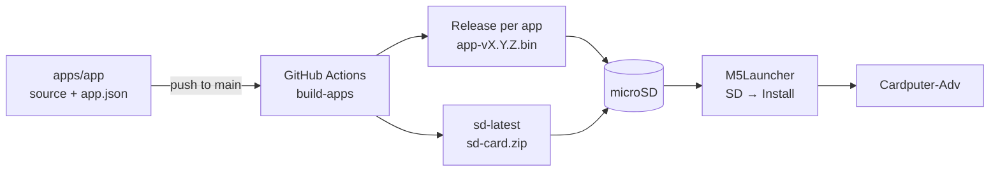
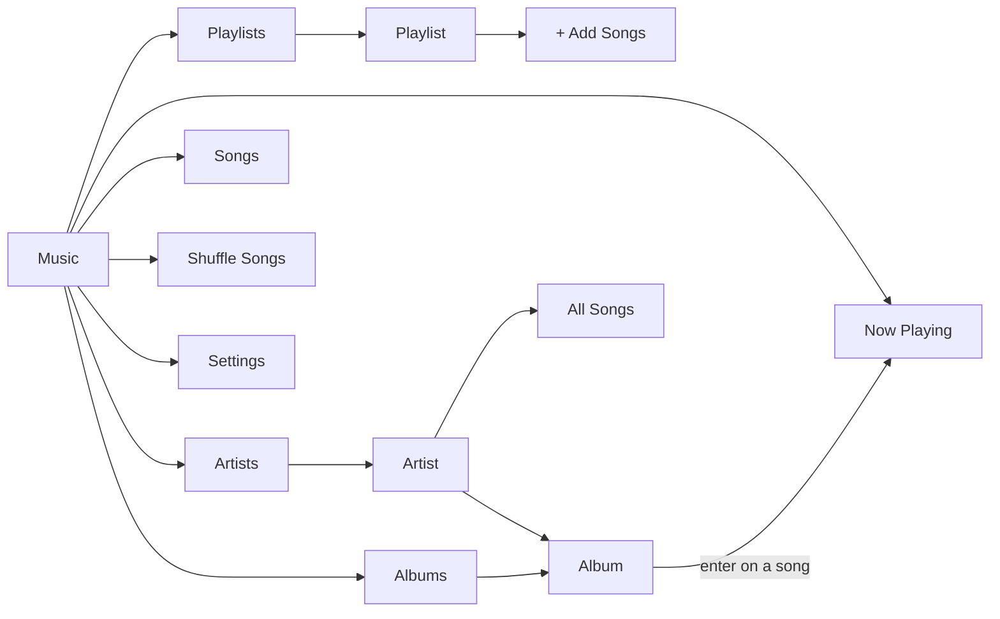
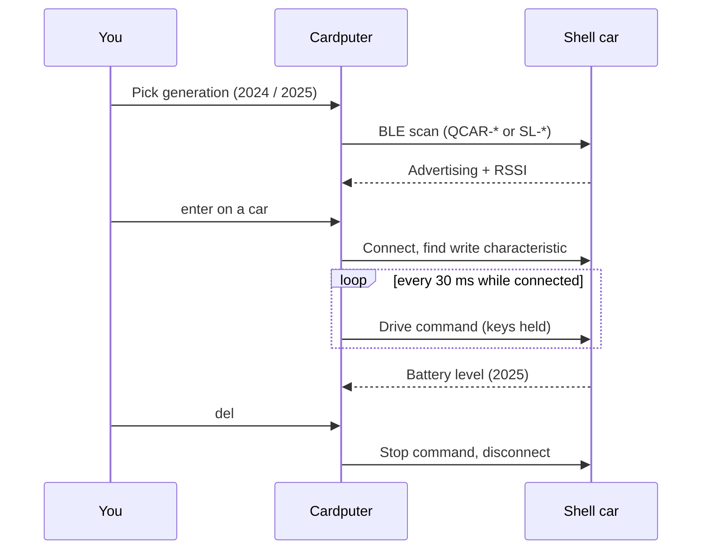
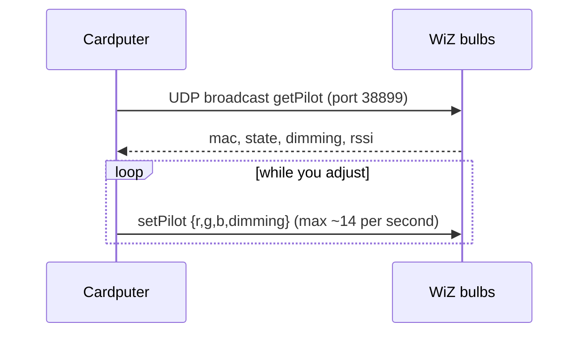
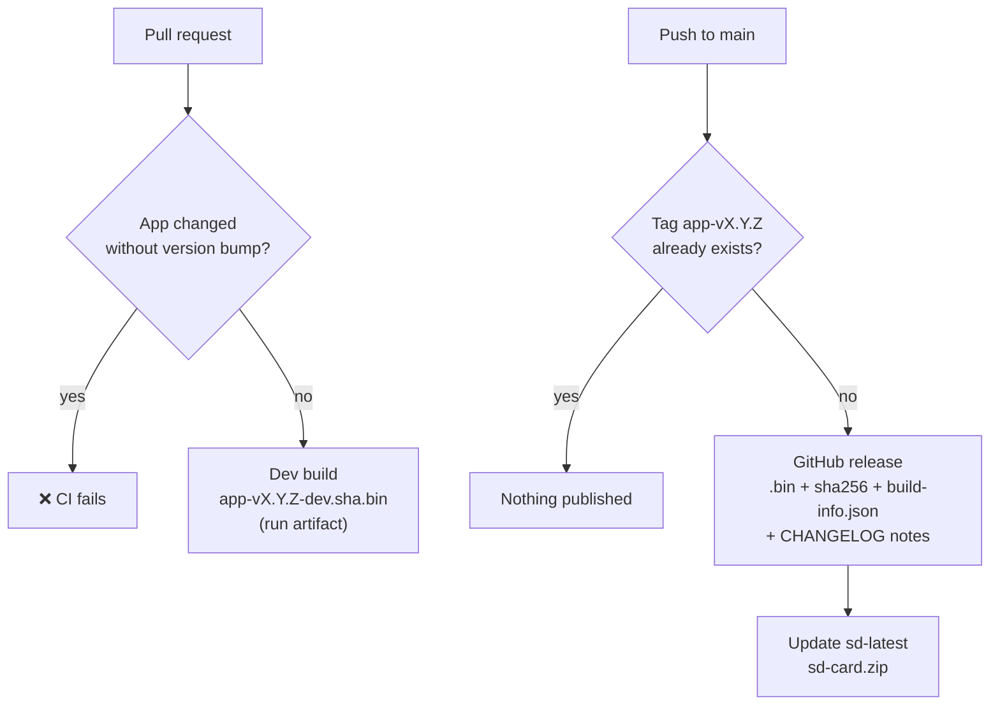

<div align="center">

# Cardputer Apps

**Games, tools and firmware for the M5Stack Cardputer-Adv, ready to launch from the SD card.**

[](https://github.com/AMasetti/Cardputer-ADV-Apps/actions/workflows/build.yml)
[](https://github.com/AMasetti/Cardputer-ADV-Apps/releases/tag/sd-latest)
<br>
[](https://docs.m5stack.com/)
[](https://www.espressif.com/en/products/socs/esp32-s3)
[](https://platformio.org/)
[](https://docs.espressif.com/projects/arduino-esp32/)
[](https://github.com/bmorcelli/Launcher)
[](#license)

</div>

---

Each folder in `apps/` is one app with its own source code and version. GitHub Actions builds only the apps that changed and publishes one `.bin` per version, ready to copy to the microSD card and launch with **M5Launcher**.



## Repository layout

```
apps/
  mp3-player/          # own app (PlatformIO)
    app.json           # name, version, builder
    CHANGELOG.md
    platformio.ini
    src/main.cpp
  shell-rc/            # own app with extra libraries (NimBLE)
  meshtastic-ra02/     # upstream firmware + own variant
    app.json           # version + meshtastic/firmware ref
    CHANGELOG.md
    build.sh           # clones upstream, copies variant/, builds
    variant/           # variant.h, pins_arduino.h, platformio.ini
    patches/           # (optional) *.patch applied on upstream
  _template/           # starting point for new apps
scripts/
  build-app.sh         # builds one app -> dist/<app>/<app>-v<ver>.bin
  changed-apps.sh      # which apps changed between two commits
  new-app.sh           # creates an app from _template
docs/
  hardware.md          # RA-02, SD and I2C sensor wiring
  BLE_SENTINEL_SPEC.md # ble-sentinel design doc
.githooks/             # commit-msg and pre-push hooks
.github/workflows/build.yml
```

## Apps

| | App | Type | Version | What it does |
|---|---|---|---|---|
| 🎵 | `mp3-player` | Media | [](https://github.com/AMasetti/Cardputer-ADV-Apps/releases/tag/mp3-player-v0.2.0) | iPod-style music player for the `.mp3` files in `/music`: browse by artist, album, song or playlist, Now Playing screen with cover art and progress bar, editable playlists. [See usage below](#mp3-player-usage) |
| 👹 | `doom` | Game | [](https://github.com/AMasetti/Cardputer-ADV-Apps/releases/tag/doom-v0.1.0) | Doom ([romalik](https://github.com/romalik/m5cardputer_doom)'s port of GBADoom/PrBoom), with support for the Adv keyboard and audio. Needs the converted WAD on the SD card. **GPL-2.0-or-later**, see [apps/doom](apps/doom/README.md) |
| 🐍 | `snake` | Game | [](https://github.com/AMasetti/Cardputer-ADV-Apps/releases/tag/snake-v0.1.0) | Classic Snake. `;` `.` `,` `/` (or WASD) move · `enter` play · `space` pause · `m` sound. Keeps your high score |
| 🧱 | `tetrix` | Game | [](https://github.com/AMasetti/Cardputer-ADV-Apps/releases/tag/tetrix-v0.1.0) | Sideways Tetrix: the 10×20 board lies on its side and pieces fall to the right, using the full width of the screen. `;` `.` move · `,` rotate (`z` counter-clockwise) · `/` soft drop · `space` hard drop · `p` pause · `m` sound. Ghost piece, 7-bag, levels and high score |
| 🎸 | `tuner` | Tool | [](https://github.com/AMasetti/Cardputer-ADV-Apps/releases/tag/tuner-v0.1.0) | Guitar, bass and ukulele tuner using the built-in microphone: big note name, cents meter with needle, chromatic mode and common tunings (standard, Drop D, DADGAD, Open G…). [See usage below](#tuner-usage) |
| 🧭 | `compass` | Tool | [](https://github.com/AMasetti/Cardputer-ADV-Apps/releases/tag/compass-v0.1.0) | Compass from the accelerometer and gyroscope: a 3D view of the Cardputer over a compass rose and a simple 2D dial with a bubble level. You set north once, since the Cardputer-Adv has no magnetometer. [See usage below](#compass-usage) |
| 📺 | `tv-b-gone` | IR remote | [](https://github.com/AMasetti/Cardputer-ADV-Apps/releases/tag/tv-b-gone-v0.1.0) | Turns TVs off (or on) over infrared by firing the original TV-B-Gone power codes for North America, Europe or both. **CC BY-SA 2.5**, see [usage below](#tv-b-gone-usage) |
| 🏎️ | `shell-rc` | BLE remote | [](https://github.com/AMasetti/Cardputer-ADV-Apps/releases/tag/shell-rc-v0.1.0) | BLE remote control for Shell Motorsport RC cars. Pick the generation: 2024 (`QCAR-*`, 4 speeds) or 2025 (`SL-*`, lights, turbo, donut, drive mode and battery level). `;` `.` `,` `/` drive · `del` disconnect. Protocols from [shell-motorsport-rc-lib](https://github.com/AMasetti/shell-motorsport-rc-lib) and [shell-motorsport-rc-lib-2025](https://github.com/AMasetti/shell-motorsport-rc-lib-2025) |
| 💡 | `led-rc` | IR remote | [](https://github.com/AMasetti/Cardputer-ADV-Apps/releases/tag/led-rc-v0.1.0) | Infrared remote for the cheap generic RGB LED strips and bulbs: the 24-key and 44-key remotes (NEC) on a color grid, with brightness, effects and shortcuts. [See usage below](#led-rc-usage) |
| 🌈 | `wiz-rc` | WiFi remote | [](https://github.com/AMasetti/Cardputer-ADV-Apps/releases/tag/wiz-rc-v0.1.0) | WiFi remote for WiZ lights over UDP (port 38899): finds the bulbs on your network, then controls power, color, white temperature, brightness and the 32 scenes, on one bulb or all at once. [See usage below](#wiz-rc-usage) |
| 🏁 | `karting` | Tool | [](https://github.com/AMasetti/Cardputer-ADV-Apps/releases/tag/karting-v0.1.0) | Kart telemetry without GPS, with the Cardputer in your pocket: it estimates the path from the IMU, detects the laps by itself by recognizing the circuit repeating, and logs the session to the microSD. Experimental. [See usage below](#karting-usage) |
| 🪪 | `ekoparty-badge` | Badge | [](https://github.com/AMasetti/Cardputer-ADV-Apps/releases/tag/ekoparty-badge-v0.1.0) | Unofficial attendee badge for the Ekoparty 22 security conference: shows the event logo and a QR code to AMasetti.com, so other attendees can scan it to reach my site. Any key toggles a full-screen QR. [See the note below](#ekoparty-badge) |
| 📡 | `meshtastic-ra02` | Firmware | [](https://github.com/AMasetti/Cardputer-ADV-Apps/releases/tag/meshtastic-ra02-v0.1.0) | Meshtastic with an RA-02 (SX1278, 433 MHz) on the EXT 14P header instead of the LoRa-1262 Cap. Wiring in [docs/hardware.md](docs/hardware.md) |
| 🛡️ | `ble-sentinel` | Security | [](https://github.com/AMasetti/Cardputer-ADV-Apps/releases/tag/ble-sentinel-v0.1.0) | Passive BLE scanner for personal counter-surveillance: flags nearby smart glasses (Meta/Luxottica, Snap) and other devices by manufacturer-data signature, with a MAC-rotation-resistant fingerprint and per-category audio alerts. Scan-only, never advertises — see [docs/BLE_SENTINEL_SPEC.md](docs/BLE_SENTINEL_SPEC.md) |

Licenses differ per app, see [License](#license).

### MP3 Player usage

Copy your music to `/music` on the microSD, one folder per album works best (`Artist - Album (Year)/01 - Title.mp3`). The app groups songs by their ID3 tags (album artist, album, track and disc number) and falls back to folder and file names when a tag is missing. Covers come from `cover.jpg`/`folder.jpg`/`front.jpg` in the album folder or from the picture embedded in the MP3 (baseline JPEG or PNG).

The first start reads every tag and saves an index to `/music/.mp3player/library.tsv`, which takes a while with a large library. Later starts only read new files. **Settings → Rebuild Library** reads everything again, for example after retagging.



| Key | Lists | Now Playing |
|---|---|---|
| `;` `.` | up / down (hold to scroll fast) | volume up / down |
| `enter` `/` | open / play from here | `enter` opens the album |
| `,` `del` | back | `,` `/` previous / next (hold: rewind / fast-forward) |
| `space` | play / pause | play / pause |
| `-` `=` | volume | volume |
| `n` `p` | next / previous song | next / previous song |
| `s` `r` | shuffle on-off / repeat off-all-one | same |
| `a` | add the selected song, album or artist to a playlist | add the current song |
| `tab` / `h` | jump to Now Playing and back / main menu | same |

**Playlists** are `.m3u` files in `/music/Playlists`, so you can also edit them on a computer.

- In **Playlists**:
  - `+ New Playlist` creates one.
  - `e` renames the selected playlist.
  - `x` deletes it (asks first).
- Inside a playlist:
  - `+ Add Songs` opens the library in add mode, where `enter` (or `a` on an album or artist) adds to that playlist and `del` goes back.
  - `m` picks up a song so you can reorder it with `;` `.`. Press `m` or `enter` to drop it.
  - `x` removes a song.

### Tetrix controls

| Key | Action |
|---|---|
| `;` `.` (or `w` `s`) | move up / down (auto-repeats while held) |
| `,` (or `a`, `x`) / `z` | rotate clockwise / counter-clockwise |
| `/` (or `d`) | soft drop |
| `space` / `enter` | hard drop |
| `p` / `m` | pause / sound on-off |

Clearing lines scores 100/300/500/800 × level, and the level goes up every 10 lines.

### Shell RC usage

1. Pick the generation with `;` `.` (or `1` `2`) and press `enter`. The last choice is remembered.
2. The app scans over BLE and lists nearby cars sorted by signal strength. `enter` connects, `r` scans again, `del` goes back.
3. Drive by holding `;` `.` `,` `/` (forward, back, left, right; WASD also works). Commands are sent every 30 ms, since the cars expect a continuous stream.
   - **2024:** `1`–`4` sets the speed.
   - **2025:** `l` lights, `t` turbo, `o` donut, `m` drive mode 1/2. Battery level is shown on screen.
4. `del` stops the car and disconnects. If the connection drops, the app goes back to the car list.



| Generation | BLE name | Command |
|---|---|---|
| 2024 | `QCAR-*` | 16 bytes, AES-128 ECB: `[0, 'C','T','L', fwd, back, left, right, 0, speed, 0…]` |
| 2025 | `SL-*` | 8 plain bytes: `[mode, fwd, back, left, right, lights, turbo, donut]`, battery on service `0x180F` |

### Tuner usage

Play one string at a time near the Cardputer. The app detects the pitch with the YIN algorithm (about 38 Hz to 1400 Hz, so it covers the low E of a bass) and shows the note in big letters. The meter shows how many cents you are off: green within ±5 cents, yellow within ±15 and red beyond that, with a hint to tune up or down.

In a guitar, bass or ukulele tuning the app picks the closest string by itself and marks it green once it has stayed in tune for a moment. If you are far from the string, it also shows which note it actually hears.

| Key | Action |
|---|---|
| `;` `.` | previous / next tuning: Chromatic, Guitar (Standard, Drop D, ½ step down, Drop C, DADGAD, Open G, Open D), 4-string Bass, Ukulele |
| `,` `/` | pick the string by hand |
| `enter` | back to picking the string automatically |
| `space` | play a reference tone of the string (the speaker and microphone share the same bus, so it listens again when the tone ends) |
| `-` `=` | A4 reference from 430 to 450 Hz |
| `n` | note names C D E or Do Re Mi |

### Compass usage

The Cardputer-Adv has an accelerometer and a gyroscope (BMI270) but **no magnetometer**, so it can't find magnetic north by itself. Point the top edge of the Cardputer at north (use a phone compass or a landmark) and press `enter`. From then on the gyroscope follows your heading, and the accelerometer keeps the 3D tilt right (Mahony filter). The heading drifts slowly, so set north again from time to time.

On start the app calibrates the gyroscope for about 2 seconds: leave the Cardputer still on a table. It keeps refining the calibration whenever it's still.

- **3D view:** the Cardputer drawn over a compass rose, seen from behind. The orange face is the top edge, and the rose turns under it as you turn.
- **2D view:** a classic dial that turns with you, with the heading in degrees, the direction (N, NE, OSO…) and a bubble level.

| Key | Action |
|---|---|
| `tab` / `m` | 3D / 2D view |
| `enter` | set north to where the Cardputer points |
| `,` `/` | turn north 5° left / right |
| `c` | calibrate the gyroscope again (keep it still) |
| `x` | change the sensor orientation, if tilting or turning moves the wrong way |

### LED RC usage

For the cheap RGB LED strips and bulbs that come with a small IR remote (24 or 44 keys). The app sends the same NEC codes as those remotes, so it works with any controller that uses them. Point the top end of the Cardputer, where the IR LED is, at the light.

The grid copies the layout of the original remote, with the real button colors. `tab` switches between the 24-key and the 44-key remote (the 44-key one scrolls). Not every clone uses the same codes: if a key does nothing, try the other remote.

| Key | Action |
|---|---|
| `;` `.` `,` `/` | move over the grid |
| `enter` | send the key. Brightness and the R/G/B up/down keys repeat while held |
| `o` / `f` | on / off (on the 44-key remote both are the same power key) |
| `-` `=` | brightness down / up |
| `r` `g` `b` `w` | red, green, blue, white |
| `tab` | 24-key / 44-key remote |

### WiZ RC usage

WiZ bulbs answer JSON commands over UDP on port 38899, with no cloud and no login, so the Cardputer only has to be on the same WiFi network as the bulbs. The WiFi name and password are saved on the Cardputer.

1. Pick your WiFi network with `;` `.` and `enter`, and type the password (`del` erases, `tab` cancels). The next time it connects by itself; `del` while connecting changes the network.
2. The app broadcasts to find the bulbs. If you have more than one, the first entry controls **all** of them. `r` searches again, `i` adds a bulb by IP when the broadcast doesn't reach it, `w` changes the network.
3. In the control screen, `tab` cycles the three modes and `space` turns the light on and off.

| Mode | Fields (`;` `.`) | Notes |
|---|---|---|
| Color | hue, saturation, brightness | `1`-`8` jump to red, orange, yellow, green, cyan, blue, violet, pink |
| White | temperature (2200-6500 K), brightness | |
| Scene | scene, brightness | the 32 WiZ scenes; `enter` applies the selected one |

`,` `/` change the value, and holding them speeds up. `del` goes back to the bulb list.



### Karting usage

Kart telemetry with no GPS: the app uses only the IMU (accelerometer and gyroscope) of the Cardputer-Adv, which can sit in any orientation in your pocket. It estimates speed and heading, draws the path, and finds the laps by recognizing that the circuit repeats, so there is no finish line to mark. It is **experimental**: the filter was tuned against a simulator (`apps/karting/sim`), not yet on a real kart, so expect to adjust it with your first sessions.

1. **Setup:** `;` `.` change the race laps by 1 (`,` `/` by 5), `r` turns the reconnaissance lap on or off, `enter` continues.
2. **Calibrate:** sit down in the kart, stopped, and press **G0**. It takes 2 s and measures gravity and the gyroscope bias. If it moves, it starts again.
3. **Race:** it starts by itself when you accelerate. Beeps: start, each lap (two short), end of the race (three long). With the reconnaissance lap on, the first lap doesn't count.
4. **A sudden stop never ends the session**, since it could be a crash. End it by holding **G0 for 5 s** or `enter` for 3 s. Other keys are ignored while racing, because they can be pressed by themselves in a pocket. After the race is finished and the kart stays still for 90 s, it closes by itself.
5. **Results:** `tab` switches between the lap table (best lap and differences), the path of the best lap colored by speed, and the session data.

The first lap is confirmed after the circuit repeats (about one lap and a bit later), and the lap times are measured at the same place of the circuit each time, which is not necessarily the real finish line.

**SD card:** the app only writes inside `/karting`, creates new files for each session (`sNNN_raw.csv`, `sNNN_laps.csv`, `sNNN_path.csv`), flushes every second, and never formats or deletes anything. If a write fails, it stops logging and keeps timing.

### TV-B-Gone usage

Point the top end of the Cardputer, where the IR LED is, at the TV and press `enter`. The app sends the power code of each TV model in the database, one after another, with a short pause between codes. A full pass takes about 50 seconds, and most TVs react within the first half.

| Key | Action |
|---|---|
| `enter` / `space` | start / stop |
| `;` `.` | region: America (NA, also Asia and the rest of the world), Europe (EU, also the Middle East and Oceania) or both |
| `l` | repeat the sequence until you stop it |
| `del` | stop |

The power codes come from the original [TV-B-Gone](https://www.tvbgone.com/) by Mitch Altman and Limor Fried, through [Ken Shirriff's Arduino port](https://github.com/shirriff/Arduino-TV-B-Gone). That code is licensed under Creative Commons Attribution-ShareAlike 2.5, so this app is too (see [apps/tv-b-gone/LICENSE](apps/tv-b-gone/LICENSE)). Please use it for fun, and not to bother people.

### Ekoparty badge

`ekoparty-badge` is a personal, non-commercial fan project: a name badge to wear at [Ekoparty](https://ekoparty.org/) that turns the Cardputer into a conference badge and shares a QR code to my website.

The Ekoparty name and logo (`apps/ekoparty-badge/assets/ekoparty22.jpg` and the `src/logo.h` generated from it) belong to **Ekoparty Security Conference** and are used here only to identify the event. This project is not affiliated with, sponsored by or endorsed by Ekoparty. If you reuse the app, replace the logo with your own image (`tools/img2h.py` converts it).

## Versioning

- Each app's version lives in its `app.json` (semver) and is documented in its `CHANGELOG.md` under a `## [x.y.z]` section.
- **Pull request**: builds the touched apps as `<app>-v<ver>-dev.<sha>.bin` (run artifact) and **fails if an app changed without a version bump**.
- **Push to `main`**: builds the touched apps and creates the `<app>-v<ver>` release with the `.bin`, its `sha256`, `build-info.json` and the CHANGELOG notes. If the tag already exists, nothing is published.
- It also updates the **`sd-latest`** release with `sd-card.zip`: the latest `.bin` of every app under `/apps`, ready to unzip onto the SD card.


- **Actions → build-apps → Run workflow** rebuilds every app (`all`) or a list (`mp3-player,meshtastic-ra02`).

If anything in `scripts/` or the workflow changes, every app is rebuilt.

## Installing on the Cardputer

1. Install M5Launcher once (M5Burner or the web flasher from bmorcelli's project).
2. Download the `.bin` from the release, or `sd-card.zip` from `sd-latest`, and copy it to the microSD card.
3. In the Launcher: **SD → pick the `.bin` → Install**. It stays as the default app until you install another one; to get back to the menu, power on while pressing a key during the splash screen.

The `.bin` files are **only the app partition** (`firmware.bin`), not the merged image, so they don't overwrite the bootloader or the Launcher. Don't flash them over USB at offset 0x0.

> Size: Meshtastic is quite large. If the Launcher says it doesn't fit, change the partition scheme in its settings. `build-app.sh` warns when a binary goes over ~3.2 MB.

## Local development

```bash
pip install platformio==6.1.19               # same version the CI pins
scripts/build-app.sh mp3-player              # -> dist/mp3-player/mp3-player-v0.2.0.bin
scripts/build-app.sh meshtastic-ra02 dev.1   # clones upstream into apps/meshtastic-ra02/.work
pio run -d apps/mp3-player -t upload         # flashes over USB directly (overwrites the Launcher)
```

`build-app.sh` uses GNU `stat` and `sha256sum`, as on the CI runner. On macOS, either install coreutils or build with `pio run -d apps/<app> -e cardputer` directly.

## New app

```bash
scripts/new-app.sh my-app
# edit apps/my-app/src/main.cpp, push -> CI publishes my-app-v0.1.0
```

To improve an app: change its folder, bump `version` in `app.json`, add the section to `CHANGELOG.md` and open a PR.

To update Meshtastic: change `upstream.ref` in `apps/meshtastic-ra02/app.json` and bump the version. If upstream changed the Cardputer-Adv variant, compare it with `variant/variant.h`.

## Git hooks

Commits must not carry AI/agent attribution (AI `Co-authored-by` trailers, `Generated with ...` lines). `commit-msg` blocks it when committing and `pre-push` checks every commit before pushing.

Enable them after cloning:

```bash
git config core.hooksPath .githooks
```

## License

My own work is **free for personal and other noncommercial use, but can't be sold or used to make money**. Apps built on someone else's open-source code keep their original license, to respect their authors.

| Part | License | Why |
|---|---|---|
| `snake`, `tetrix`, `tuner`, `compass`, `shell-rc`, `led-rc`, `wiz-rc`, `karting`, `ekoparty-badge`, `ble-sentinel`, `scripts/`, CI, docs | [PolyForm Noncommercial 1.0.0](LICENSE) | My own code |
| `doom` | [GPL-2.0-or-later](apps/doom/LICENSE) | Based on id Software's Doom, PrBoom, GBADoom and romalik's port |
| `mp3-player` | [GPL-3.0](apps/mp3-player/LICENSE) | Links [ESP8266Audio](https://github.com/earlephilhower/ESP8266Audio), which is GPL-3.0 |
| `meshtastic-ra02` | [GPL-3.0](apps/meshtastic-ra02/LICENSE) | Built from the [Meshtastic firmware](https://github.com/meshtastic/firmware), which is GPL-3.0 |
| `tv-b-gone` | [CC BY-SA 2.5](apps/tv-b-gone/LICENSE) | Uses the TV-B-Gone power-code database by Mitch Altman and Limor Fried, which is CC BY-SA 2.5 |

**PolyForm Noncommercial** lets anyone use, study, modify and share the code for personal, hobby, educational, research or other noncommercial purposes, as long as they keep the license and the `Required Notice` line. Selling it, or using it to make money, is not allowed without my written permission. Get in touch through [amasetti.com](https://amasetti.com) if you'd like to use it commercially.

The GPL apps can be used, modified and redistributed under their GPL terms, including commercially. The GPL doesn't allow adding a noncommercial restriction on top of it. Their source code is this repository plus the upstream version pinned in each `app.json`.

`tv-b-gone` can be used, modified and shared, including commercially, as long as you credit the original authors and share your changes under the same CC BY-SA license.

Libraries compiled into the firmware keep their own licenses: M5Cardputer and M5GFX (MIT) and NimBLE-Arduino (Apache-2.0).

Third-party names and logos are not covered by these licenses: the Ekoparty logo belongs to Ekoparty Security Conference, and "Doom" is a trademark of id Software. The Doom WAD files are not included.
