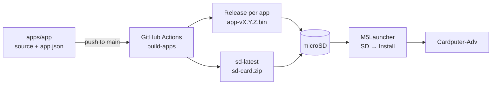
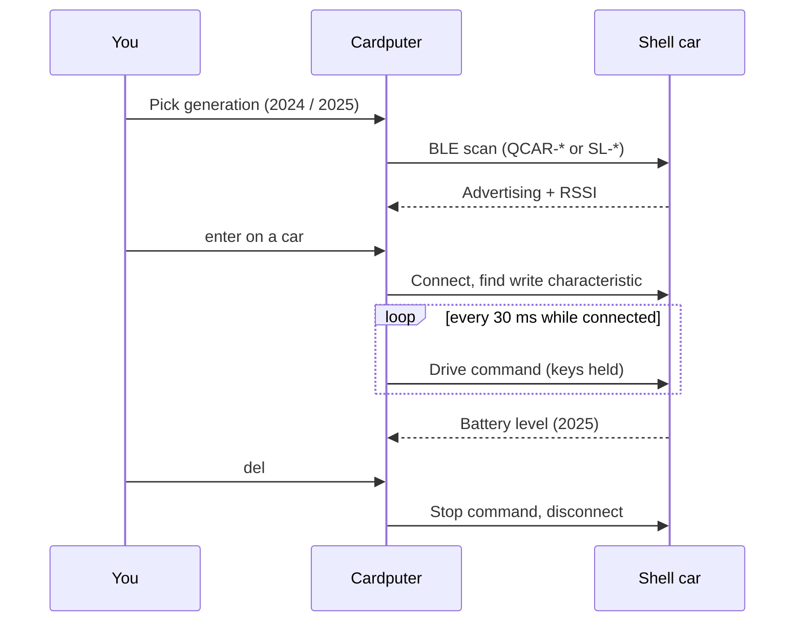
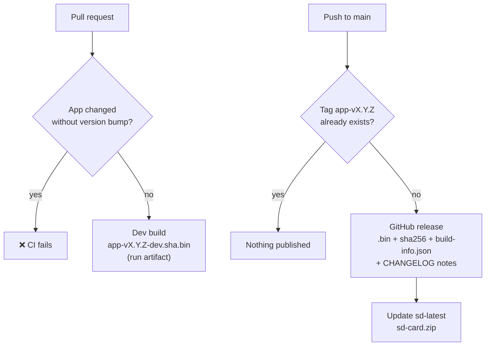

<div align="center">

# Cardputer Apps

**Games, tools and firmware for the M5Stack Cardputer-Adv, ready to launch from the SD card.**

[](https://github.com/AMasetti/Cardputer-ADV-Apps/actions/workflows/build.yml)
[](https://github.com/AMasetti/Cardputer-ADV-Apps/releases/tag/sd-latest)
<br>
[](https://docs.m5stack.com/)
[](https://www.espressif.com/en/products/socs/esp32-s3)
[](https://platformio.org/)
[](https://docs.espressif.com/projects/arduino-esp32/)
[](https://github.com/bmorcelli/Launcher)
[](#license)

</div>

---

Each folder in `apps/` is one app with its own source code and version. GitHub Actions builds only the apps that changed and publishes one `.bin` per version, ready to copy to the microSD card and launch with **M5Launcher**.



## Repository layout

```
apps/
  mp3-player/          # own app (PlatformIO)
    app.json           # name, version, builder
    CHANGELOG.md
    platformio.ini
    src/main.cpp
  shell-rc/            # own app with extra libraries (NimBLE)
  meshtastic-ra02/     # upstream firmware + own variant
    app.json           # version + meshtastic/firmware ref
    CHANGELOG.md
    build.sh           # clones upstream, copies variant/, builds
    variant/           # variant.h, pins_arduino.h, platformio.ini
    patches/           # (optional) *.patch applied on upstream
  _template/           # starting point for new apps
scripts/
  build-app.sh         # builds one app -> dist/<app>/<app>-v<ver>.bin
  changed-apps.sh      # which apps changed between two commits
  new-app.sh           # creates an app from _template
docs/
  hardware.md          # RA-02, SD and I2C sensor wiring
.githooks/             # commit-msg and pre-push hooks
.github/workflows/build.yml
```

## Apps

| | App | Type | Version | What it does |
|---|---|---|---|---|
| 🎵 | `mp3-player` | Media | [](https://github.com/AMasetti/Cardputer-ADV-Apps/releases/tag/mp3-player-v0.1.0) | Plays the `.mp3` files in `/music` on the SD card. `;` `.` list · `enter` play · `space` pause · `,` `/` previous/next · `-` `=` volume · `s` shuffle |
| 👹 | `doom` | Game | [](https://github.com/AMasetti/Cardputer-ADV-Apps/releases/tag/doom-v0.1.0) | Doom ([romalik](https://github.com/romalik/m5cardputer_doom)'s port of GBADoom/PrBoom), with support for the Adv keyboard and audio. Needs the converted WAD on the SD card. **GPL-2.0-or-later**, see [apps/doom](apps/doom/README.md) |
| 🐍 | `snake` | Game | [](https://github.com/AMasetti/Cardputer-ADV-Apps/releases/tag/snake-v0.1.0) | Classic Snake. `;` `.` `,` `/` (or WASD) move · `enter` play · `space` pause · `m` sound. Keeps your high score |
| 🧱 | `tetrix` | Game | [](https://github.com/AMasetti/Cardputer-ADV-Apps/releases/tag/tetrix-v0.1.0) | Sideways Tetrix: the 10×20 board lies on its side and pieces fall to the right, using the full width of the screen. `;` `.` move · `,` rotate (`z` counter-clockwise) · `/` soft drop · `space` hard drop · `p` pause · `m` sound. Ghost piece, 7-bag, levels and high score |
| 🏎️ | `shell-rc` | BLE remote | [](https://github.com/AMasetti/Cardputer-ADV-Apps/releases/tag/shell-rc-v0.1.0) | BLE remote control for Shell Motorsport RC cars. Pick the generation: 2024 (`QCAR-*`, 4 speeds) or 2025 (`SL-*`, lights, turbo, donut, drive mode and battery level). `;` `.` `,` `/` drive · `del` disconnect. Protocols from [shell-motorsport-rc-lib](https://github.com/AMasetti/shell-motorsport-rc-lib) and [shell-motorsport-rc-lib-2025](https://github.com/AMasetti/shell-motorsport-rc-lib-2025) |
| 🪪 | `ekoparty-badge` | Badge | [](https://github.com/AMasetti/Cardputer-ADV-Apps/releases/tag/ekoparty-badge-v0.1.0) | Unofficial attendee badge for the Ekoparty 22 security conference: shows the event logo and a QR code to AMasetti.com, so other attendees can scan it to reach my site. Any key toggles a full-screen QR. [See the note below](#ekoparty-badge) |
| 📡 | `meshtastic-ra02` | Firmware | [](https://github.com/AMasetti/Cardputer-ADV-Apps/releases/tag/meshtastic-ra02-v0.1.0) | Meshtastic with an RA-02 (SX1278, 433 MHz) on the EXT 14P header instead of the LoRa-1262 Cap. Wiring in [docs/hardware.md](docs/hardware.md) |

Licenses differ per app, see [License](#license).

### Tetrix controls

| Key | Action |
|---|---|
| `;` `.` (or `w` `s`) | move up / down (auto-repeats while held) |
| `,` (or `a`, `x`) / `z` | rotate clockwise / counter-clockwise |
| `/` (or `d`) | soft drop |
| `space` / `enter` | hard drop |
| `p` / `m` | pause / sound on-off |

Clearing lines scores 100/300/500/800 × level, and the level goes up every 10 lines.

### Shell RC usage

1. Pick the generation with `;` `.` (or `1` `2`) and press `enter`. The last choice is remembered.
2. The app scans over BLE and lists nearby cars sorted by signal strength. `enter` connects, `r` scans again, `del` goes back.
3. Drive by holding `;` `.` `,` `/` (forward, back, left, right; WASD also works). Commands are sent every 30 ms, since the cars expect a continuous stream.
   - **2024:** `1`–`4` sets the speed.
   - **2025:** `l` lights, `t` turbo, `o` donut, `m` drive mode 1/2. Battery level is shown on screen.
4. `del` stops the car and disconnects. If the connection drops, the app goes back to the car list.



| Generation | BLE name | Command |
|---|---|---|
| 2024 | `QCAR-*` | 16 bytes, AES-128 ECB: `[0, 'C','T','L', fwd, back, left, right, 0, speed, 0…]` |
| 2025 | `SL-*` | 8 plain bytes: `[mode, fwd, back, left, right, lights, turbo, donut]`, battery on service `0x180F` |

### Ekoparty badge

`ekoparty-badge` is a personal, non-commercial fan project: a name badge to wear at [Ekoparty](https://ekoparty.org/) that turns the Cardputer into a conference badge and shares a QR code to my website.

The Ekoparty name and logo (`apps/ekoparty-badge/assets/ekoparty22.jpg` and the `src/logo.h` generated from it) belong to **Ekoparty Security Conference** and are used here only to identify the event. This project is not affiliated with, sponsored by or endorsed by Ekoparty. If you reuse the app, replace the logo with your own image (`tools/img2h.py` converts it).

## Versioning

- Each app's version lives in its `app.json` (semver) and is documented in its `CHANGELOG.md` under a `## [x.y.z]` section.
- **Pull request**: builds the touched apps as `<app>-v<ver>-dev.<sha>.bin` (run artifact) and **fails if an app changed without a version bump**.
- **Push to `main`**: builds the touched apps and creates the `<app>-v<ver>` release with the `.bin`, its `sha256`, `build-info.json` and the CHANGELOG notes. If the tag already exists, nothing is published.
- It also updates the **`sd-latest`** release with `sd-card.zip`: the latest `.bin` of every app under `/apps`, ready to unzip onto the SD card.


- **Actions → build-apps → Run workflow** rebuilds every app (`all`) or a list (`mp3-player,meshtastic-ra02`).

If anything in `scripts/` or the workflow changes, every app is rebuilt.

## Installing on the Cardputer

1. Install M5Launcher once (M5Burner or the web flasher from bmorcelli's project).
2. Download the `.bin` from the release, or `sd-card.zip` from `sd-latest`, and copy it to the microSD card.
3. In the Launcher: **SD → pick the `.bin` → Install**. It stays as the default app until you install another one; to get back to the menu, power on while pressing a key during the splash screen.

The `.bin` files are **only the app partition** (`firmware.bin`), not the merged image, so they don't overwrite the bootloader or the Launcher. Don't flash them over USB at offset 0x0.

> Size: Meshtastic is quite large. If the Launcher says it doesn't fit, change the partition scheme in its settings. `build-app.sh` warns when a binary goes over ~3.2 MB.

## Local development

```bash
pip install platformio==6.1.19               # same version the CI pins
scripts/build-app.sh mp3-player              # -> dist/mp3-player/mp3-player-v0.1.0.bin
scripts/build-app.sh meshtastic-ra02 dev.1   # clones upstream into apps/meshtastic-ra02/.work
pio run -d apps/mp3-player -t upload         # flashes over USB directly (overwrites the Launcher)
```

`build-app.sh` uses GNU `stat` and `sha256sum`, as on the CI runner. On macOS, either install coreutils or build with `pio run -d apps/<app> -e cardputer` directly.

## New app

```bash
scripts/new-app.sh my-app
# edit apps/my-app/src/main.cpp, push -> CI publishes my-app-v0.1.0
```

To improve an app: change its folder, bump `version` in `app.json`, add the section to `CHANGELOG.md` and open a PR.

To update Meshtastic: change `upstream.ref` in `apps/meshtastic-ra02/app.json` and bump the version. If upstream changed the Cardputer-Adv variant, compare it with `variant/variant.h`.

## Git hooks

Commits must not carry AI/agent attribution (AI `Co-authored-by` trailers, `Generated with ...` lines). `commit-msg` blocks it when committing and `pre-push` checks every commit before pushing.

Enable them after cloning:

```bash
git config core.hooksPath .githooks
```

## License

My own work is **free for personal and other noncommercial use, but can't be sold or used to make money**. Apps built on someone else's open-source code keep their original license, to respect their authors.

| Part | License | Why |
|---|---|---|
| `snake`, `tetrix`, `shell-rc`, `ekoparty-badge`, `scripts/`, CI, docs | [PolyForm Noncommercial 1.0.0](LICENSE) | My own code |
| `doom` | [GPL-2.0-or-later](apps/doom/LICENSE) | Based on id Software's Doom, PrBoom, GBADoom and romalik's port |
| `mp3-player` | [GPL-3.0](apps/mp3-player/LICENSE) | Links [ESP8266Audio](https://github.com/earlephilhower/ESP8266Audio), which is GPL-3.0 |
| `meshtastic-ra02` | [GPL-3.0](apps/meshtastic-ra02/LICENSE) | Built from the [Meshtastic firmware](https://github.com/meshtastic/firmware), which is GPL-3.0 |

**PolyForm Noncommercial** lets anyone use, study, modify and share the code for personal, hobby, educational, research or other noncommercial purposes, as long as they keep the license and the `Required Notice` line. Selling it, or using it to make money, is not allowed without my written permission. Get in touch through [amasetti.com](https://amasetti.com) if you'd like to use it commercially.

The GPL apps can be used, modified and redistributed under their GPL terms, including commercially. The GPL doesn't allow adding a noncommercial restriction on top of it. Their source code is this repository plus the upstream version pinned in each `app.json`.

Libraries compiled into the firmware keep their own licenses: M5Cardputer and M5GFX (MIT) and NimBLE-Arduino (Apache-2.0).

Third-party names and logos are not covered by these licenses: the Ekoparty logo belongs to Ekoparty Security Conference, and "Doom" is a trademark of id Software. The Doom WAD files are not included.
